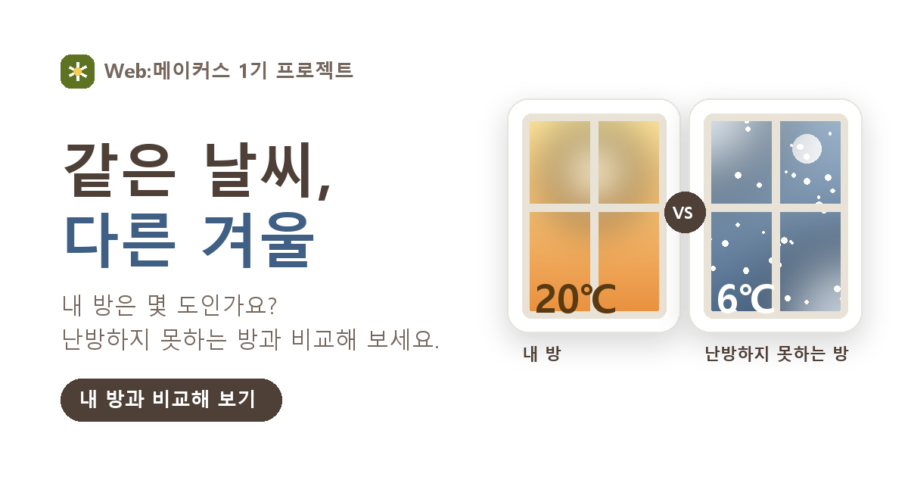

# 🌡️ 같은 날씨, 다른 겨울

> 같은 영하의 밤이라도, 방 안의 겨울은 집마다 다릅니다.

오늘 우리 동네 실시간 기온으로 **내 방과 난방하지 못하는 방의 온도를 비교**하고, 그 방에서 겨울을 나는 아이의 하루와 지금 필요한 것을 보여 주는 웹서비스입니다.

**🔗 바로 가기: https://ryu-min-ji.github.io/same-weather/**



<br>

## 📌 프로젝트 개요

| 항목 | 내용 |
| --- | --- |
| 프로그램 | 굿네이버스 서울인천권역본부 Web:메이커스 1기, 1주차 웹서비스 실습 |
| 주제 | 겨울철 아동 에너지 빈곤 |
| 관련 SDGs | 1 빈곤 종식 · 3 건강과 웰빙 · 7 깨끗한 에너지 · 10 불평등 감소 |
| 형태 | 개인 프로젝트 (굿네이버스 공식 서비스가 아닙니다) |

<br>

## 🤔 왜 만들었나요

- 소득 하위 20% 가구는 쓸 수 있는 소득의 **10%**를 난방·전기 같은 에너지 비용으로 씁니다. 전체 평균(4.8%)의 두 배가 넘습니다.
- 세계보건기구(WHO)는 건강을 지키려면 실내가 **최소 18℃**는 되어야 한다고 권고합니다.
- 집 안에 오래 머무는 아이들은 이 추위를 가장 먼저, 가장 오래 겪습니다.

"에너지 빈곤"이라는 말은 멀게 느껴지지만, **지금 내 방 온도와 나란히 놓으면** 그 차이가 바로 보입니다. 숫자 대신 비교로 공감을 끌어내고, 작은 행동으로 이어지게 하는 것이 목표입니다.

<br>

## ✨ 주요 기능

### 1. 두 방 비교하기
- 위치 권한 또는 도시 선택으로 **실시간 기온과 오늘 밤 최저기온**을 불러옵니다.
- 방 온도를 몰라도 **지금 차림**(반팔, 긴팔, 담요, 겉옷)과 **하고 있는 일**(공부, 잠들기 전, 씻기, 식사)만 고르면 됩니다.
- **집 형태**(옥탑방, 반지하, 낡은 단독주택, 오래된 연립)에 따라 그 방의 온도가 달라집니다.
- 결과로 두 방의 온도 차이, 같은 시간 그 방의 장면, 기온에 맞춰 지금 필요한 물품을 보여 줍니다.
- **"더 추운 날이라면?"** 슬라이더로 기온을 바꾸면 모든 결과가 실시간으로 바뀝니다.

### 2. 그 아이의 하루
- 앞으로 24시간 기온으로 추정한 **방 온도 그래프**와 WHO 권장 18℃ 기준선을 보여 줍니다.
- 그래프 위에 마우스를 올리면 시간별 바깥 기온과 방 온도가 표시됩니다.
- 아침, 하교 후, 저녁, 밤 네 장면으로 하루를 따라갑니다.

### 3. 전국의 그 방들
- 전국 10개 도시의 오늘 밤 추정 방 온도를 **지도와 추운 순서**로 보여 줍니다.
- 도시를 누르면 위쪽 비교도 그 도시 기준으로 바뀝니다.

### 4. 내 방 1℃가 할 수 있는 일
- 보일러를 1~3℃ 낮췄을 때 한 겨울 동안 아낄 수 있는 금액을 계산하고, 월 1만원 정기 나눔 횟수로 바꿔 보여 줍니다.
- 이름을 넣으면 **"1℃ 나눔 약속" 카드 이미지**를 만들어 줍니다. (이름은 저장되지 않습니다.)

### 5. 알리고 나누기
- 결과를 인스타 스토리 크기의 **결과 카드 이미지**로 저장하거나 링크로 공유할 수 있습니다.
- 에너지 빈곤에 대한 **오해 3가지**를 바로잡고, 굿네이버스의 '사랑 ON(溫) 난방비' 사업으로 연결합니다.

<br>

## 🛠️ 기술

- **HTML / CSS / JavaScript** (프레임워크 없이 순수 코드)
- 서버와 데이터베이스 없이 동작 (GitHub Pages로 배포)
- 기온 정보: [Open-Meteo API](https://open-meteo.com/) (무료, 키 필요 없음)
- 그래프, 지도: SVG 직접 그리기 / 카드 이미지: Canvas
- 폰트: Pretendard, Black Han Sans
- 반응형 레이아웃, 키보드 조작, '동작 줄이기' 설정 지원

```
same-weather/
├── index.html            # 페이지 구조
├── style.css             # 디자인
├── app.js                # 기능 (기온, 비교, 그래프, 지도, 카드 이미지)
├── og.png                # 링크 공유 미리보기 이미지
├── favicon.svg           # 브라우저 탭 아이콘
└── apple-touch-icon.png  # 휴대폰 홈 화면 아이콘
```

<br>

## 💻 내 컴퓨터에서 실행하기

```bash
git clone https://github.com/ryu-min-ji/same-weather.git
cd same-weather
python -m http.server 5500
```

브라우저에서 `http://localhost:5500`을 엽니다. VS Code의 Live Server 확장으로 열어도 됩니다.

<br>

## ⚠️ 알아 두세요

- **방 온도는 실측값이 아닙니다.** 바깥 기온과 집 구조를 바탕으로 한 설명용 단순 모델로 추정했습니다.
- 아이의 장면은 에너지 빈곤 가정 아이들의 겨울을 바탕으로 **재구성한 이야기**입니다.
- 난방비 절감액은 서울 도시가스 평균 단가 기준이며, 실제 금액은 집마다 다를 수 있습니다.

<br>

## 📚 자료 출처

- [저소득층 에너지 지출 비중, 평균의 2배 (경향신문, 국가데이터처 가계동향조사)](https://www.khan.co.kr/article/202603152012005)
- [WHO Housing and health guidelines (2018)](https://www.ncbi.nlm.nih.gov/books/NBK535294/)
- [난방 1℃ 절감 효과 (세계일보, 한국에너지공단 자료)](https://www.segye.com/newsView/20251201501679)
- [2025 사랑 ON(溫) 난방비 모집 안내 (세종특별자치시)](https://www.sejong.go.kr/bbs/R0071/view.do?nttId=B000000141230Sk2jK5w)
- [서울 에너지복지 플랫폼 (서울특별시, 2014)](https://news.seoul.go.kr/env/archives/50065)
- [에너지 빈곤층 "여름을 어찌 날꼬" (주간경향)](https://weekly.khan.co.kr/article/202006121300071)

<br>

---

굿네이버스 서울인천권역본부 Web:메이커스 1기 · 류민지
